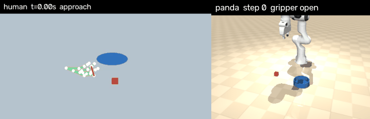
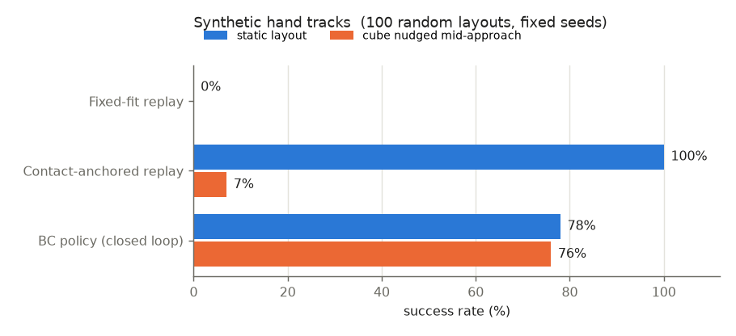
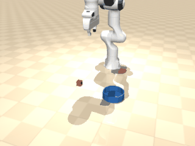
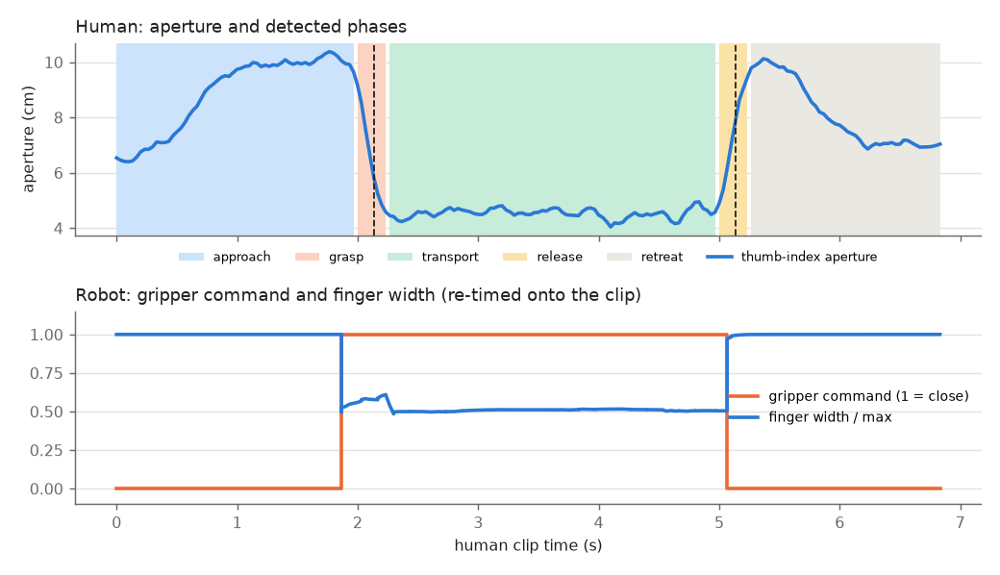

# Phone-to-Robot Retargeting

Contact-anchored retargeting of phone-recorded hand demos to a Franka Panda in MuJoCo.

A few phone clips of my hand picking up a small object and dropping it in a bowl are turned
into hundreds of robot demonstrations, and a closed-loop policy is trained on them. MediaPipe
gives a 3D wrist track and a thumb-index aperture; the two contact moments in each clip (hand
closes on the object, hand opens over the bowl) are pinned to the object and bowl in the sim,
and the rest of the human motion is carried over. Because the anchors can be placed anywhere,
one clip yields a demo for any cube/bowl layout.



*Pipeline check on a synthetic hand track (left, rendered skeleton) driving the Panda (right).
Replace with the phone-clip version after `make real`.*

## Recording the data

- Phone propped still (against a book is fine), side or 3/4 view of the table, landscape, 30 fps.
- Start with the hand resting on the table, then: reach, pinch a small object (~4 cm), lift,
  move it 20-40 cm, drop it in a bowl, take the hand away. 5-8 s per clip.
- Keep the whole hand in frame and avoid covering the thumb and index tips with the object.
- 3-5 clips, slightly different paths. Copy them to `data/raw/` (`.mp4` or `.mov`).

## Install

```bash
git clone https://github.com/megazron/phone-to-robot-retargeting
cd phone-to-robot-retargeting
make setup      # .venv with pinned deps (CPU torch), Panda model from mujoco_menagerie, MediaPipe model
```

Tested on Ubuntu (WSL2), Python 3.12, CPU only. Rendering uses the default GL backend if a
display exists, otherwise OSMesa (`MUJOCO_GL=egl` also works on GPU servers).

## Run

```bash
make real        # data/raw/*.mp4 -> MediaPipe -> data/tracks + data/clips -> everything below
make demo        # same, from the committed hand tracks in data/tracks (no MediaPipe)
make synthetic   # pipeline check on generated hand tracks, no video needed
make smoke       # pytest, about 30 s on CPU
```

`python run_all.py data/raw` is the same as `make real`. Each run writes to `results/<real|synthetic>/`:
`metrics.json`, `metrics.md`, `results.png`, `phases.png`, `side_by_side.gif`, `bc_nudged.gif`,
`bc_policy.pt`. A full run (600 re-anchored episodes, 40 epochs, 100 eval layouts x 5 conditions)
takes about 6 minutes on 22 CPU cores.

## Method

**1. Hand track** (`touchpoint/hand.py`). MediaPipe HandLandmarker returns 21 image landmarks
and 21 metric "world" landmarks centred on the hand. For a pinhole camera each landmark gives
`u - cx = f (X + tx) / (Z + tz)`, which is linear in the hand translation `t`; solving it over all
21 points is the apparent-hand-size depth cue, using the whole hand rather than one palm length.
`f` comes from an assumed 66 deg phone FOV, so the global scale is only approximate. Missed frames
are interpolated, then Savitzky-Golay smoothed.

**2. Phases.** The aperture is normalised per clip and thresholded with hysteresis
(close < 0.30, open > 0.55). The longest closed interval is the grasp; its end is the release.

**3. Contact-anchored retargeting** (`touchpoint/retarget.py`). With `p(t)` the wrist, `h_g`, `h_r` the
wrist at grasp and release, `g` the cube and `r` a point above the bowl:

```
x(t) = g + F S H^T (p(t) - h_g) + w(t) * residual

H : human task frame. e1 = transport direction projected on the table, e3 = table normal
    (plane through the wrist at rest, grasp and release, i.e. three moments near the table)
F : robot task frame. f1 = cube -> bowl, f3 = world z
S : diag(s_along, 1, 1). s_along makes the transport length match; lift height, sideways
    curvature and approach direction keep their (metric) human values
w : minimum-jerk blend of the residual that makes the start pose and the release land exactly
```

The camera pose and the depth scale never have to be known: only the two contact points have to
be right, and those are taken from the sim. The trajectory is uniformly re-timed so the TCP
stays under 0.35 m/s (speed profile kept), the gripper closes once the TCP reaches the grasp
anchor, and short dwells let the fingers close and open.

**4. Sim** (`touchpoint/sim.py`). Panda from mujoco_menagerie, 4 cm cube, bowl, random layouts
within the reachable area. A 20 Hz Cartesian command goes through damped least-squares IK to the
Panda's joint position servos; grasping is physical (friction), no welds. This is a LIBERO-style
tabletop task built directly in MuJoCo, not LIBERO itself (its robosuite stack was not used).

**5. Policy** (`touchpoint/policy.py`). Every clip is re-anchored to random layouts and executed;
only successful rollouts are kept. During collection the command is perturbed with Gaussian noise
(DART) while the label stays the clean plan, and 30% of episodes nudge the cube mid-approach with
the plan re-anchored on the fly, so the data contains recoveries. A 3x256 MLP maps
(command position, cube and bowl relative to it, finger width) to a velocity command and a
gripper logit. Training takes about a minute on CPU.

## Results

Success over 100 random layouts (fixed seeds). "Nudged" moves the cube 5 cm when the gripper is
within 8 cm of it.

**Phone clips: (run `make real` on your clips; table goes here)**

**Synthetic hand tracks (pipeline check only, not real data):**

| Method | Cube nudged mid-approach | Success |
|---|---|---|
| Fixed-fit replay (one global fit, no anchoring) | no | 0% |
| Contact-anchored replay (open loop) | no | 100% |
| BC policy (closed loop) | no | 78% |
| Contact-anchored replay (open loop) | yes | 7% |
| BC policy (closed loop) | yes | 76% |

100 random layouts, fixed seeds.



BC policy with the cube nudged mid-approach (synthetic tracks):





## What worked

- Anchoring on contacts. One global fit of the human track to the workspace (fixed-fit replay)
  fails as soon as the layout moves a few centimetres; anchoring makes open-loop replay succeed
  on every layout tested (synthetic tracks), without knowing the camera pose.
- Using the re-anchored replays as an expert. The same anchoring that maps a clip to a layout also
  re-plans after a cube nudge, which gives recovery labels for free.
- Velocity labels over a short lookahead (8 steps) instead of single-step deltas, and dropping
  frames where the plan is waiting. Without these the policy imitated the pauses and stalled
  at the cube.
- Closing the gripper on arrival at the anchor rather than at the human threshold crossing.

## What did not / limitations

- Monocular depth from hand size is approximate (10-20% scale error with a wrong FOV guess).
  This is the reason for anchoring: only the along-transport scale matters and it is fixed by
  the anchors. Lift height inherits the scale error.
- Wrist orientation is ignored; the Panda grasps top-down with a fixed yaw. Clips with a side
  grasp still retarget, but the grasp itself is a top-down one.
- The open-loop replay is near-perfect in this sim, so the policy's job is mainly robustness
  (nudge column). The BC policy still fails some static layouts, mostly by hovering at the cube
  without closing. More data or action chunking should fix most of it.
- The state-based policy sees the cube pose from the simulator, not from pixels.
- The scene is a simplified LIBERO-style task in raw MuJoCo, not a LIBERO benchmark task.

## Next steps

- Port the scene and the anchoring to LIBERO (robosuite) and report on a LIBERO pick-place task.
- Use the re-anchored episodes, rendered from the sim camera with language labels, to post-train
  a small VLA (e.g. SmolVLA) instead of the state MLP.
- RL fine-tuning (residual policy on top of BC) with the success check as reward.
- Use the wrist orientation from the world landmarks for the grasp yaw.

## Layout

```
run_all.py              one entry point (MediaPipe -> retarget -> collect -> train -> eval -> figures)
touchpoint/hand.py      MediaPipe, depth solve, smoothing, overlays
touchpoint/retarget.py  phase segmentation, contact-anchored retargeting, re-anchoring
touchpoint/sim.py       MuJoCo scene, IK, success check
touchpoint/policy.py    data collection with DART + nudges, MLP behaviour cloning
touchpoint/evaluate.py  fixed-seed evaluation
touchpoint/synthetic.py synthetic MediaPipe-like tracks for tests
data/tracks, data/clips processed hand tracks and downsampled clips (committed)
```
