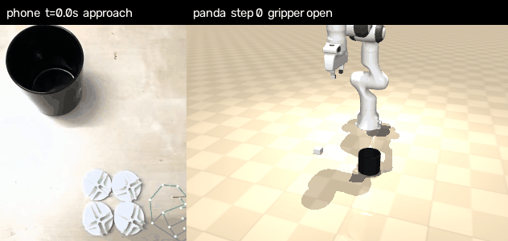
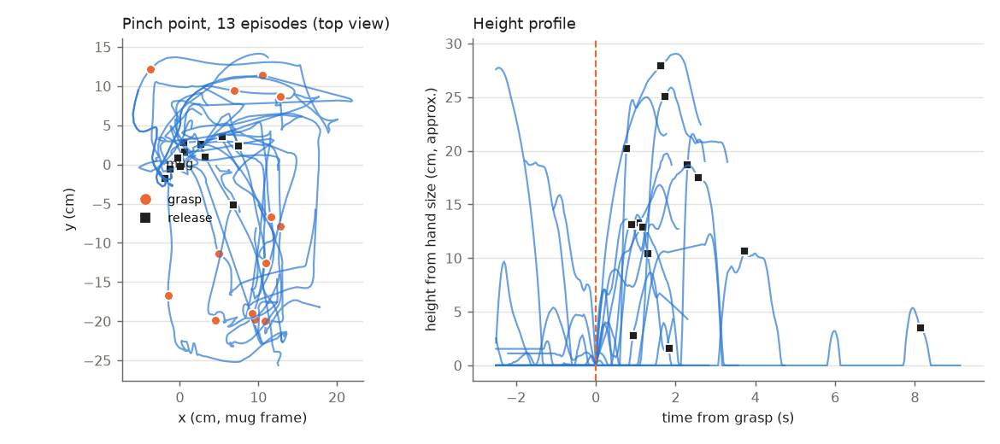
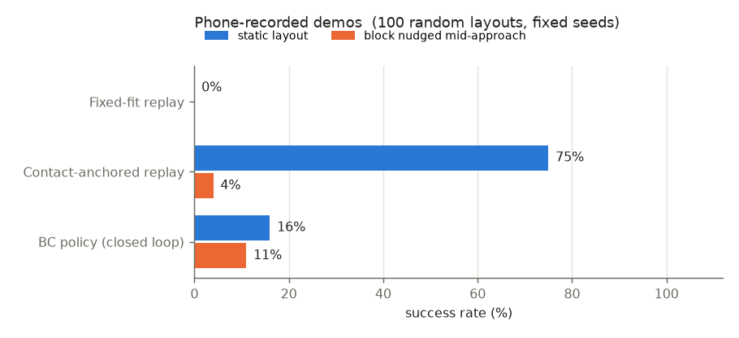
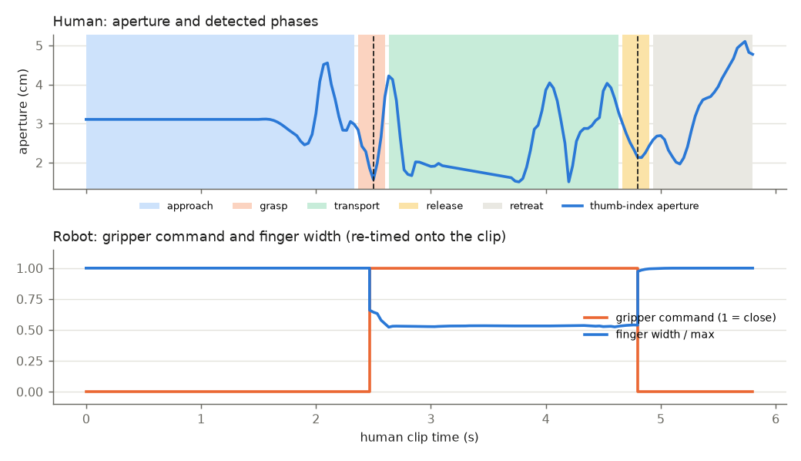

# Phone-to-Robot Retargeting

Contact-anchored retargeting of phone-recorded hand demos to a Franka Panda in MuJoCo.

I filmed my hand dropping small plastic discs into a mug with a handheld phone (4 clips,
13 pick-and-drop episodes, about 100 s of video). Each episode is turned into a 3D pinch-point
trajectory in a mug-centred frame, and the two contact moments (fingers close on a disc, fingers
open over the mug) are pinned to the object and the mug in the simulator. Everything between the
anchors keeps the shape and timing of my hand. Because the anchors can be placed anywhere, the
13 episodes become hundreds of robot demonstrations, which train a closed-loop policy.



*Left: phone clip with MediaPipe landmarks and the detected phase. Right: the Panda executing the
same episode, re-anchored to a different block and mug position.*

## Data

`data/raw/clip01-04.mp4`: top-down, handheld phone, 30 fps, beige table, one black mug, four
white ~4 cm discs. Each clip has 3-4 sequential episodes (pick a disc, carry it to the mug, drop
it, return). The originals were cropped around the mug to cancel hand drift and strip audio and
metadata (`scripts/prepare_clips.py`); only the crops are in the repo.
`data/tracks/*.npz` holds the per-frame MediaPipe landmarks and the mug track, so the results can
be reproduced without running MediaPipe.

To record your own: phone roughly above the table, mug and objects in view the whole time, hand
coming in from one side, a pause with the hand closed on the object and a clear opening over the mug.

## Install and run

```bash
git clone https://github.com/megazron/phone-to-robot-retargeting
cd phone-to-robot-retargeting
make setup     # .venv with pinned deps (CPU torch), Panda from mujoco_menagerie, MediaPipe model
make demo      # results from the committed hand tracks (no MediaPipe), about 5 min on 22 CPU cores
make real      # same, but re-runs MediaPipe and mug tracking on data/raw/*.mp4
make smoke     # pytest on synthetic tracks, about 30 s
```

Outputs go to `results/real/`: `metrics.json`, `metrics.md`, `results.png`, `episodes.png`,
`phases.png`, `side_by_side.gif/.mp4`, `bc_nudged.gif`, `bc_policy.pt`. Tested on Ubuntu (WSL2),
Python 3.12, CPU only. Rendering uses the default GL backend with a display, OSMesa without one.

## Method

**1. Mug-centric hand track** (`touchpoint/topdown.py`). The phone moves, so pixels are not a
frame. The mug is: it is tracked per frame as a dark circle and its rim radius in pixels (rim
diameter about 8 cm) gives the metres-per-pixel of that frame. The pinch point (midpoint of
thumb and index tips from MediaPipe) is expressed relative to the mug centre, which cancels the
drift. Height comes from the apparent hand size, which scales with 1 / distance to the camera:
`z = D (1 - L_grasp / L)`, with `L_grasp` the hand size while it touches the table at the grasp and
`D` the camera-table distance estimated from the mug radius and an assumed focal length.
This is the weakest signal (roughly +-30%, see the height plot below).

**2. Episodes.** In a top-down view the thumb-index aperture is noisy (the fingers occlude each
other), but distance to the mug is very clean. A release is the closest approach in each
interval where the pinch point is within 9 cm of the mug axis; the grasp is the frame with the
smallest aperture while the hand is out at the disc, between the previous release and this one.



**3. Contact-anchored retargeting** (`touchpoint/retarget.py`). With `p(t)` the pinch point,
`h_g`, `h_r` its position at grasp and release, `g` the block and `r` a point above the mug:

```
x(t) = g + F S H^T (p(t) - h_g) + w(t) * residual

H : human task frame, e1 = grasp -> release on the table, e3 = up
F : robot task frame, f1 = block -> mug, f3 = world z
S : diag(s_along, 1, 1); s_along makes the carry length match, the sideways curve and
    the height profile keep their metric human values
w : minimum-jerk blend of the residual so the start pose and the release land exactly
```

Neither camera pose nor depth scale has to be right; only the two contacts, and those come from
the sim. Three constraints make up for the noisy height: the final approach stays inside a cone
above the object (no sideways sweep into it), the carry is lifted to clear the mug rim if the
measured peak is too low, and it does not dip below the release height once lifted. The path is
smoothed and uniformly re-timed to stay under 0.35 m/s (shape of the speed profile kept). The
gripper closes on arrival at the grasp anchor, with short dwells for the fingers.

**4. Sim** (`touchpoint/sim.py`). Panda from mujoco_menagerie, a 4.2 x 4.2 x 3 cm block standing in
for the disc (a 3 mm disc cannot be pinched top-down by the Panda fingers), an open mug 10 cm tall,
random layouts. 20 Hz Cartesian commands, damped least-squares IK to the joint servos, physical
friction grasp. This is a LIBERO-style tabletop task in raw MuJoCo, not LIBERO itself.

**5. Policy** (`touchpoint/policy.py`). Each episode is re-anchored to random layouts and executed;
successful rollouts are kept. The executed command gets Gaussian noise (DART) while the label is
the clean plan, and 30% of rollouts nudge the block mid-approach and re-anchor the plan on the fly,
so the data contains recoveries. A 3x256 MLP maps (commanded TCP position, block and mug relative
to it, finger width) to a velocity command and a gripper logit.

## Results

Success over 100 random block/mug layouts with fixed seeds; each layout replays one of the 13
episodes. "Nudged" moves the block 5 cm when the gripper is within 8 cm of it.

| Method | Block nudged mid-approach | Success |
|---|---|---|
| Fixed-fit replay (one global fit, no anchoring) | no | 0% |
| Contact-anchored replay (open loop) | no | 75% |
| BC policy (closed loop) | no | 16% |
| Contact-anchored replay (open loop) | yes | 4% |
| BC policy (closed loop) | yes | 11% |

100 random layouts, fixed seeds.



Reading the table: anchoring is what makes the human episodes usable at all (0% -> 75%), and
the open-loop replay has no way to react when the block moves (4%). The BC policy is the weak
part on real data: it reacts to the nudge (11% vs 4%) but succeeds in only 16% of static
layouts. On synthetic side-view tracks the same method reached 78% (earlier scene with a bowl and a cube), so the gap comes from
the 13 real episodes being far less consistent (different approach paths, heights and pauses);
a single MLP averages them and misses the block by a few centimetres or closes too early.



`make synthetic` runs the same pipeline on generated side-view hand tracks (`touchpoint/synthetic.py`).
It is a pipeline check used by the tests; its numbers are not reported as results.

## What worked

- Anchoring on contacts. A single global fit of the human track to the workspace (fixed-fit
  replay) fails once the layout differs from the one it was fitted on; anchoring per layout works
  without camera calibration.
- The mug as a moving reference. It removes the handheld drift and gives metric scale per frame.
- Re-anchoring as the expert: the same mapping re-plans after a nudge and labels recoveries.
- Velocity labels over an 8-step lookahead and dropping frames where the plan waits; without them
  the policy copied the pauses and stalled at the object.

## What did not / limitations

- Height from hand size is noisy; the carry and approach constraints above exist because the raw
  height made the arm clip the mug rim or sweep the block off the table.
- Episode splitting finds 13 of the 14 episodes; one in clip02 merges two drops into one long
  episode, and a few episodes have poor grasp timing and fail even open loop.
- The BC policy does not reach the replay's success rate (see Results). Things tried that did not
  help: 1000 instead of 600 demos, lower DART noise, extra features relative to the measured TCP.
  Likely fixes: action chunking or a diffusion/flow head for the multi-modal demos, conditioning on
  the episode, or filtering the episodes that replay unreliably.
- Wrist orientation is ignored (top-down grasp, fixed yaw), and the block is bigger than the disc.
- The policy uses the simulator's block pose, not pixels. One block per episode, so the sequential
  multi-disc structure of the clips is not reproduced in one rollout.

## Next steps

- Port the scene and the anchoring to LIBERO and evaluate on a LIBERO pick-place task.
- Render the re-anchored episodes from a sim camera with language labels and post-train a small
  VLA (e.g. SmolVLA) on them instead of the state MLP.
- RL fine-tuning of the BC policy with the success check as reward; sequential multi-object episodes.

## Layout

```
run_all.py               entry point: tracks -> episodes -> retarget -> collect -> train -> eval -> figures
touchpoint/topdown.py    mug tracking, mug-centric pinch track, episode splitting
touchpoint/hand.py       MediaPipe, side-view depth solve, overlays
touchpoint/retarget.py   contact-anchored retargeting, re-anchoring
touchpoint/sim.py        MuJoCo scene, IK, success check
touchpoint/policy.py     DART + nudge data collection, MLP behaviour cloning
touchpoint/evaluate.py   fixed-seed evaluation
touchpoint/synthetic.py  synthetic MediaPipe-like tracks for tests
scripts/prepare_clips.py how the raw phone videos were cropped
```
